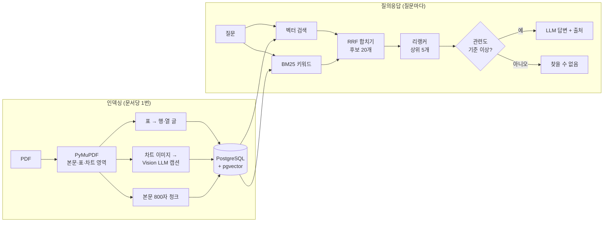

# ReportQA

> 공공기관 통계 보고서 PDF에 질문하면, **본문뿐 아니라 차트와 표까지 읽고** 근거 쪽수와 함께 답하는 멀티모달 문서 RAG 시스템

**상태:** ✅ 8주 개발 완료 (2026-11) · FastAPI + PostgreSQL/pgvector + Streamlit + Docker · MIT License

<!-- 시연 GIF: docs/images/demo.gif 를 녹화해 넣으면 아래 줄의 주석을 풉니다 -->
<!--  -->

---

## 1. 결과 한눈에 보기

110문항 테스트셋(텍스트 40 / 표 30 / 차트 30 / 모름 10)으로 버전마다 **한 가지씩만 바꿔** 측정했습니다.

| 버전 | 바꾼 것 | Recall@5 | 정답률 | 텍스트 | 표 | 차트(벡터) | 차트(이미지) | 환각률 |
|---|---|---|---|---|---|---|---|---|
| v0 | 텍스트만 (수업 방식 기본 RAG) | 87.0% | 67.3% | 92.5% | 53.3% | 61.1% | 0% | 0% |
| v1 | + 표 구조 살리기 | 89.0% | 73.6% | 95.0% | 83.3% | 44.4% | 0% | 0% |
| v2 | + 차트 Vision 캡션 | 92.0% | 88.2% | 95.0% | 90.0% | 83.3% | 58.3% | 0% |
| **v3** | + 하이브리드 검색·리랭커 | **98.0%** | **95.5%** | 92.5% | 96.7% | 94.4% | **100%** | 0% |

- **정답률 67.3% → 95.5%.** 가장 큰 개선은 차트: 그림 차트(PDF 안에 글자가 없는 차트)는 텍스트 RAG(v0)에서 **0%** → Vision 캡션(v2) **58.3%** → 검색 개선(v3) **100%**
- v2→v3: 남은 오답 대부분이 "검색 실패"였고, BM25(단어 일치) + 리랭커로 Recall@5 92% → 98%
- 환각률은 모든 버전에서 0% (근거에 없으면 "모름"으로 답하도록 설계)
- **Recall@5:** 정답 쪽이 검색 상위 5개 안에 있는 비율 · **환각률:** 문서에 없는 질문 10개에 답을 지어낸 비율
- **채점:** LLM 채점(gpt-6.1-terra), 사람이 직접 채점한 20문항과 **일치율 95%**
- 문항별 결과 [eval/results/](eval/results/) · 분석 노트북 [v0](notebooks/03_eval_v0.ipynb) · [v1](notebooks/04_table_v1.ipynb) · [v2](notebooks/05_vision_v2.ipynb) · [v3](notebooks/06_hybrid_v3.ipynb)

## 2. 왜 만들었나

통계 보고서의 핵심 숫자는 대부분 **차트와 표** 안에 있습니다. 일반적인 문서 RAG는 PDF에서 글자만 꺼내기 때문에:

| 질문 | 텍스트 RAG(v0)가 본 것 | 결과 |
|---|---|---|
| 2025년 4분기 음악 산업 매출액은? (표) | `음악 2,507,287 3,046,733 3,400,830 … 4,056,713 (9.0%) 1.0%` — 어느 숫자가 몇 분기인지 모름 | 다른 분기 값으로 오답 |
| 2023년 5월 25~29세 졸업자 증감은? (그림 차트) | 아무것도 없음 (차트가 이미지라 글자 0개) | "모름" |
| 2015년 건강보험료 부담 비율은? (벡터 차트) | `70% 60.8 64.5 60% 59.4 61.7 …` — 연도 순서 정보 없음 | 실행할 때마다 맞았다 틀렸다 |

ReportQA는 **표는 행·열 구조를 살린 글로**, **차트는 Vision LLM이 쓴 "계열 · 연도 = 값" 캡션으로** 바꿔 함께 검색합니다.

```
표   → - 음악: 2025 년 P 3 분기 = 4,015,543; 2025 년 P 4 분기 = 4,056,713; 증감률 전분기 대비 = 1.0%
차트 → [차트] 사회보험료 부담정도
       - 건강보험 · 2015년 = 64.5%
       - 건강보험 · 2017년 = 61.7%
```

## 3. 주요 기능

| 기능 | 설명 | 화면 |
|---|---|---|
| 문서 등록 | PDF를 올리면 본문·표·차트를 추출해 저장 (백그라운드 처리, 진행률 표시) | 문서 관리 |
| 질문하기 | 답변 + 출처(문서·쪽·본문/표/차트) + 근거 카드(차트면 원본 이미지) | 질문하기 |
| 근거 상세 | 원본 페이지에 근거 영역 빨간 상자, 캡션, "왜 뽑혔나"(벡터·BM25·리랭커 순위) | 근거 상세 |
| 모름 응답 | 근거가 부족하면 지어내지 않고 "찾을 수 없음" (환각률 0%) | 질문하기 |
| 평가 | 110문항 버전별 비교표, 유형별 그래프, 오답 사례 | 평가 결과 |

<!-- 화면 캡처: docs/images/ 에 넣고 주석을 풉니다
| 질문하기 | 근거 상세 | 평가 결과 |
|---|---|---|
|  |  |  |
-->

## 4. 시스템 구조



| 구성 | 역할 | 코드 |
|---|---|---|
| Streamlit 화면 | 업로드·질문·근거·평가 화면. 서버에 요청만 보냄 | [ui/](ui/) |
| FastAPI 서버 | 업로드·처리·질문 API ([명세](docs/api_spec.md)) | [app/main.py](app/main.py) |
| 문서 처리 | 표 재구성, 차트 영역 찾기, Vision 캡션, 청크 | [app/ingest/](app/ingest/) |
| 검색 | 벡터 + BM25(kiwipiepy) + RRF + 리랭커 | [app/retrieval/](app/retrieval/) |
| 답변 생성 | 근거로만 답하고 출처 표시, 없으면 "모름" ([프롬프트](docs/prompts.md)) | [app/generation/](app/generation/) |
| DB | 문서·차트 이미지·청크(벡터)·질문 기록 ([구조](docs/db_schema.md)) | [app/db/](app/db/) |
| 평가 | 110문항 테스트셋, 채점 규칙, LLM 채점 | [eval/](eval/) |

## 5. 기술 스택과 선택 이유

| 구분 | 사용 기술 | 고른 이유 |
|---|---|---|
| PDF 처리 | PyMuPDF | 글자 좌표·도형·이미지 정보를 모두 줘서 표를 좌표로 재구성하고 차트 영역을 찾을 수 있음 |
| LLM | OpenAI gpt-6-luna(답변), gpt-6.1-terra(Vision 캡션·채점) | 답변은 싸고 빠른 모델, 이미지 읽기·채점은 정확한 모델 |
| 임베딩 | text-embedding-3-small | 문서 3개 전체 임베딩 약 $0.006 |
| 벡터 DB | PostgreSQL + pgvector | 문서 정보와 벡터를 DB 하나에서 관리 (실험은 FAISS) |
| 키워드 검색 | rank-bm25 + kiwipiepy | "2025년", "15~19세" 같은 정확한 단어 일치 보완. 한국어 조사 제거 |
| 리랭커 | BAAI/bge-reranker-v2-m3 (내 PC CPU) | 다국어(한국어) 지원 공개 모델, API 비용 없음 |
| 서버·화면 | FastAPI, Streamlit | 자동 API 문서(/docs), 파이썬만으로 화면 |
| 배포 | Docker Compose, GitHub Actions(pytest) | `docker compose up` 한 줄 실행, 푸시마다 테스트 자동 실행 |

## 6. 실행 방법

### 준비물
- Linux 또는 WSL (Ubuntu), Docker, OpenAI API 키
- 보고서 PDF 3개: [docs/data_sources.md](docs/data_sources.md)의 링크에서 받아 `data/pdf/`에 저장

### 방법 A. Docker로 한 번에 실행 (권장)
```bash
git clone https://github.com/saehoon2/ReportQA.git
cd ReportQA
cp .env.example .env          # OPENAI_API_KEY 와 모델 이름을 채움 (항목 설명: docs/env_spec.md)
docker compose up -d --build  # DB·서버·화면 3개 컨테이너 실행
docker compose exec api python -m app.ingest.load_samples   # 기본 문서 3개 등록 (처음 1번)
```
- 화면: http://localhost:8501 · API 문서: http://localhost:8000/docs
- 첫 질문 때 리랭커 모델(약 2GB)을 내려받습니다. 받지 않으려면 `.env`에 `USE_RERANKER=false`
- 기본 문서 처리 비용: 차트 캡션 약 $0.18 + 임베딩 약 $0.006 (캡션은 `data/captions/`에 저장되어 다시 만들지 않음)

### 방법 B. 내 PC에서 직접 실행 (개발용)
```bash
python3 -m venv .venv && source .venv/bin/activate
pip install torch==2.15.0 --index-url https://download.pytorch.org/whl/cpu
pip install -r requirements.txt
docker compose up -d db                    # DB만 Docker로
python -m app.ingest.load_samples          # 기본 문서 등록
uvicorn app.main:app --port 8000           # 서버 (터미널 1)
streamlit run ui/streamlit_app.py          # 화면 (터미널 2)
```

### 테스트
```bash
pytest -q        # OpenAI·DB 없이 실행되는 단위 테스트 (GitHub Actions에서도 자동 실행)
```

## 7. 개발 과정과 트러블슈팅

| 주차 | 내용 | 결과물 |
|---|---|---|
| 1 | 환경 구성, 보고서 3개 선정 (공공누리 확인, 스캔본·인포그래픽 제외) | [data_sources.md](docs/data_sources.md) |
| 2 | v0 텍스트 RAG | [02 노트북](notebooks/02_text_rag_v0.ipynb) |
| 3 | 테스트셋 110문항, LLM 채점 검증(95%), v0 평가, v1 표 구조 | [평가 가이드](docs/evaluation_guide.md), [03](notebooks/03_eval_v0.ipynb)·[04](notebooks/04_table_v1.ipynb) |
| 4 | v2 차트 Vision 캡션 | [05 노트북](notebooks/05_vision_v2.ipynb), [프롬프트](docs/prompts.md) |
| 5 | FastAPI 서버, PostgreSQL + pgvector | [API 명세](docs/api_spec.md), [DB 구조](docs/db_schema.md) |
| 6 | v3 하이브리드 검색 + 리랭커, "모름" 기준 | [06 노트북](notebooks/06_hybrid_v3.ipynb) |
| 7 | Streamlit 화면, Docker Compose, pytest, GitHub Actions | [ui/](ui/), [tests/](tests/) |
| 8 | 결과 정리 | 이 README |

### ① 표의 숫자가 어느 열인지 알 수 없음 (v0 표 53%)
- **문제:** "2025년 4분기 음악 매출"을 물으면 같은 행의 다른 분기 값을 답함
- **원인:** PDF 글자 추출은 표를 `음악 2,507,287 3,046,733 …` 한 줄로 만듦. PyMuPDF 표 추출 기능은 한국 통계표에서 칸이 무너짐
- **해결:** 표 **위치만** PyMuPDF로 찾고, 칸은 **글자 좌표로 직접 재구성** → "행 이름: 열 제목 = 값". 여러 열에 걸친 큰 제목은 "자기가 덮는 열들의 가운데에 놓인다"는 성질로 배정
- **결과:** 표 53.3% → **83.3%** (v1). 처음 재구성은 76.7%였고, "2025. 5"가 "2025."와 "5"로 쪼개져 가짜 열이 생기는 문제를 찾아 고친 뒤 올라감

### ② 같은 표가 15~29세용과 15~34세용 두 개 (검색 혼동)
- **원인:** D01은 본문(15~29세)과 부록 통계표(15~34세)에 같은 이름의 표가 있음
- **해결:** 쪽마다 큰 제목(Ⅲ. / 1.)을 읽어 **섹션 경로를 표 머리말에 붙임** → `[Ⅲ. 통계표 > 1. 청년층(15~34세) 부가조사 통계표]`

### ③ 그림 차트가 수백 개의 가는 띠로 잘려 있음 (차트 영역 못 찾음)
- **문제:** D01 25쪽 차트를 찾지 못함
- **원인:** 차트 이미지가 높이 1pt짜리 띠 1,800여 개로 저장되어 있었고, 사각형 합치기 함수가 높이 0인 띠를 "빈 사각형"으로 무시
- **해결:** 띠에 최소 높이 1pt를 주고 4pt 이내의 띠를 합침 → 차트 띠 40개 → 47개, 테스트셋 차트 쪽 모두 포함

### ④ 통계 질문은 "뜻"보다 "정확한 단어"가 중요 (v2 Recall 92%)
- **문제:** 캡션에 답이 있는데도 검색 상위 5개에 못 듦 (그림 차트 5문항 등)
- **원인:** 캡션은 `'22.5`(22년 5월), 질문은 "2022년 5월". 벡터 검색은 뜻이 비슷한 다른 차트를 먼저 가져옴
- **해결:** BM25 키워드 검색(한국어 형태소 분석으로 조사 제거)을 더하고 RRF로 순위를 합친 뒤, 리랭커로 다시 채점 (노트북 06에서 같은 후보로 방식별 비교: 벡터만 92% · BM25만 96% · 합치면 99%)
- **결과:** Recall@5 98%, 정답률 88.2% → **95.5%**. 리랭커를 더하면 Recall은 오히려 1%p 낮았음 (하이브리드만 쓴 경우의 정답률은 비용을 아끼려 측정하지 않아, 리랭커 단독 효과는 아직 확인하지 못함)

### ⑤ 같은 문항이 실행할 때마다 맞았다 틀렸다 함 (v1 차트 61% → 44%)
- **원인 분석:** 표 코드 변경 때문인지 확인 → 차트 정답 숫자는 v0·v1 모두 본문에 그대로 있었음. 숫자에 연도 정보가 없어 모델이 실행마다 다르게 짐작하고 있었음
- **결론:** 운에 기대던 문항 → v2 캡션으로 해결 (83.3%). 버전 비교는 1~2문항이 아닌 **유형별 큰 변화**로 판단

## 8. 한계와 다음 계획

- **문서 3개, 테스트셋 110문항:** 결론을 일반화하기엔 작음. 계획은 문서 10~15개
- **캡션 오독:** D03 16쪽에서 겹친 레이블 두 값이 서로 바뀌어 기록됨 → 근거 화면에서 원본 이미지를 함께 보여주는 이유. 오독률을 체계적으로 재지는 못함
- **쪽 단위 Recall:** 정답 "쪽"이 검색됐는지만 봄. 같은 쪽의 다른 청크가 검색된 경우를 구분하지 못함
- **응답 속도:** 리랭커를 CPU로 돌려 Docker에서 질문 1개에 약 20~30초 (첫 질문은 모델을 불러오느라 1분 정도). 빠르게 하려면 `.env`에서 `RETRIEVE_TOP_K=10` 또는 `USE_RERANKER=false` (정확도와 맞바꿈), 근본적으로는 GPU나 더 작은 리랭커
- **비용:** Vision 캡션이 가장 큼 (문서 3개 약 $0.18). 큰 문서는 `MAX_CAPTION_PAGES`로 상한
- **다음:** 문서 추가, 후속 질문(대화 기억), 여러 보고서 간 비교 질문, 클라우드 배포

## 9. 폴더 구조

```
ReportQA/
├── app/
│   ├── main.py          # FastAPI 시작점
│   ├── config.py        # 설정 (.env 읽기)
│   ├── qa.py            # 질의응답 흐름 (검색 → 관련도 → 답변)
│   ├── ingest/          # 문서 처리: 표 재구성, 차트 캡션, 청크, DB 저장
│   ├── retrieval/       # BM25, 하이브리드(RRF), 리랭커
│   ├── generation/      # 답변 프롬프트
│   └── db/              # 테이블 정의, DB 읽기·쓰기
├── ui/                  # Streamlit 화면
├── eval/                # 테스트셋, 채점 코드, 버전별 결과
├── notebooks/           # 실험 노트북 01~06
├── tests/               # pytest
├── docs/                # 데이터 출처, 평가 가이드, 프롬프트, API·DB 명세
├── data/                # PDF·이미지·캡션·인덱스 (저장소에는 미포함)
├── Dockerfile, docker-compose.yml
└── requirements.txt
```

## 10. 데이터 출처와 이용 조건

이 프로젝트는 아래 기관의 공공저작물을 이용합니다. 원본 PDF는 저장소에 포함하지 않으며 수정·재배포하지 않습니다.
- 국가데이터처, 「2026년 5월 경제활동인구조사 청년층 부가조사 결과」 (공공누리 제1유형)
- 한국콘텐츠진흥원, 「2025년 4분기 및 연간 콘텐츠산업 동향분석 보고서」 (공공누리 제4유형)
- 국가데이터처, 「2025년 사회조사 결과」 (공공누리 제3유형)

다운로드 링크와 선정 기준: [docs/data_sources.md](docs/data_sources.md) · 코드 라이선스: [MIT](LICENSE)
