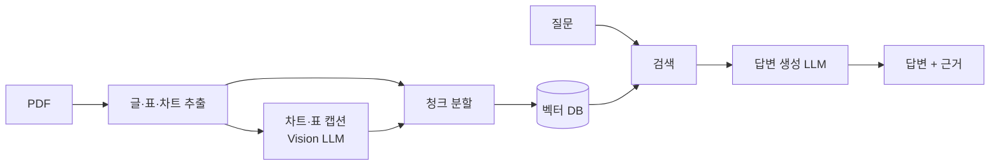

# ReportQA

> 공공기관 통계 보고서 PDF에 질문하면, **본문뿐 아니라 차트와 표까지 읽고** 근거 쪽수와 함께 답하는 멀티모달 문서 RAG 시스템

**상태:** 🚧 개발 중 (1주차 / 8주)

---

## 1. 왜 만들었나

통계 보고서의 핵심 숫자는 대부분 **차트와 표** 안에 있습니다.
하지만 일반적인 문서 RAG는 PDF에서 글자만 추출하기 때문에, "20대 고용률은 얼마인가?"처럼 차트를 봐야 답할 수 있는 질문에는 답하지 못합니다.

ReportQA는 차트·표를 Vision LLM으로 글(캡션)로 바꿔 함께 검색하고,
**텍스트만 쓰는 RAG와 비교해 얼마나 좋아지는지 직접 평가**하는 것을 목표로 합니다.

## 2. 주요 기능 (예정)

| 기능 | 설명 | 상태 |
|---|---|---|
| 문서 등록 | PDF를 올리면 글·표·차트를 추출해 저장 | 예정 |
| 질문하기 | 질문에 대한 답변과 근거(문서·쪽수·차트 이미지) 제공 | 예정 |
| 모름 응답 | 근거가 부족하면 지어내지 않고 "모름"으로 답변 | 예정 |
| 평가 | 110문항 테스트셋으로 버전별 성능 비교 | 예정 |

## 3. 시스템 구조



## 4. 기술 스택

| 구분 | 사용 기술 | 도입 시점 |
|---|---|---|
| 언어 | Python 3.14 | 1주차 ✅ |
| PDF 처리 | PyMuPDF | 1주차 ✅ |
| LLM·임베딩 | OpenAI API, LangChain | 2주차 |
| 벡터 검색 | FAISS (실험) → PostgreSQL + pgvector (서버) | 2주차 / 5주차 |
| 서버 | FastAPI | 5주차 |
| 검색 개선 | BM25 하이브리드 검색, 리랭커 | 6주차 |
| 화면 | Streamlit | 7주차 |
| 배포 | Docker, docker-compose | 7주차 |

## 5. 데이터

국내 공공기관이 발행한 통계 보고서 PDF 3개로 시작합니다. (최종 10~15개 예정)

| ID | 보고서 | 발행 기관 |
|---|---|---|
| D01 | 2026년 5월 경제활동인구조사 청년층 부가조사 결과 | 국가데이터처 |
| D02 | 2025년 4분기 및 연간 콘텐츠산업 동향분석 보고서 | 한국콘텐츠진흥원 |
| D03 | 2025년 사회조사 결과 | 국가데이터처 |

- 원본 PDF는 저작권과 용량 문제로 **저장소에 포함하지 않습니다.**
- 다운로드 링크, 이용 조건(공공누리), 선정 기준은 [docs/data_sources.md](docs/data_sources.md)에 정리했습니다.

## 6. 시작하기

### 준비물
- Linux 또는 WSL (Ubuntu)
- Python 3.14
- OpenAI API 키 (2주차부터 필요)

### 설치
```bash
# 1. 저장소 받기
git clone https://github.com/saehoon2/ReportQA.git
cd ReportQA

# 2. 가상환경 만들고 켜기
python3 -m venv .venv
source .venv/bin/activate

# 3. 라이브러리 설치
pip install -r requirements.txt

# 4. 환경설정 파일 만들기 (값은 직접 입력)
cp .env.example .env
```

- 설정 항목 설명: [docs/env_spec.md](docs/env_spec.md)
- PDF는 [docs/data_sources.md](docs/data_sources.md)의 링크에서 받아 `data/pdf/`에 넣습니다.

## 7. 폴더 구조 (현재)

```
ReportQA/
├── data/           # PDF 등 데이터 (저장소에는 미포함)
├── docs/           # 설계·기록 문서
├── notebooks/      # 실험용 주피터 노트북
├── .env.example    # 환경설정 견본
└── requirements.txt
```

## 8. 개발 일정

| 주차 | 내용 | 상태 |
|---|---|---|
| 1 | 환경 구성, 데이터 선정 | 🚧 진행 중 |
| 2 | 텍스트 RAG 기본형 (v0) | 예정 |
| 3 | 표 구조 반영 (v1), 테스트셋 작성 | 예정 |
| 4 | 차트·표 Vision 캡션 (v2) | 예정 |
| 5 | FastAPI 서버, PostgreSQL + pgvector | 예정 |
| 6 | 하이브리드 검색 + 리랭커 (v3) | 예정 |
| 7 | Streamlit 화면, Docker | 예정 |
| 8 | 배포, 결과 정리 | 예정 |

## 9. 평가 계획

110문항 테스트셋(텍스트 40 / 표 30 / 차트 30 / 모름 10)으로 버전별 성능을 비교합니다.

| 버전 | 내용 | 검색 정확도 (Recall@5) | 답변 정확도 |
|---|---|---|---|
| v0 | 텍스트만 | - | - |
| v1 | + 표 구조 | - | - |
| v2 | + 차트·표 Vision 캡션 | - | - |
| v3 | + 하이브리드 검색·리랭커 | - | - |

> 결과는 실험이 끝나는 대로 채웁니다.

## 10. 출처 표시

이 프로젝트는 아래 기관의 공공저작물을 이용합니다.
- 국가데이터처, 「2026년 5월 경제활동인구조사 청년층 부가조사 결과」 (공공누리 제1유형)
- 한국콘텐츠진흥원, 「2025년 4분기 및 연간 콘텐츠산업 동향분석 보고서」 (공공누리 제4유형)
- 국가데이터처, 「2025년 사회조사 결과」 (공공누리 제3유형)
