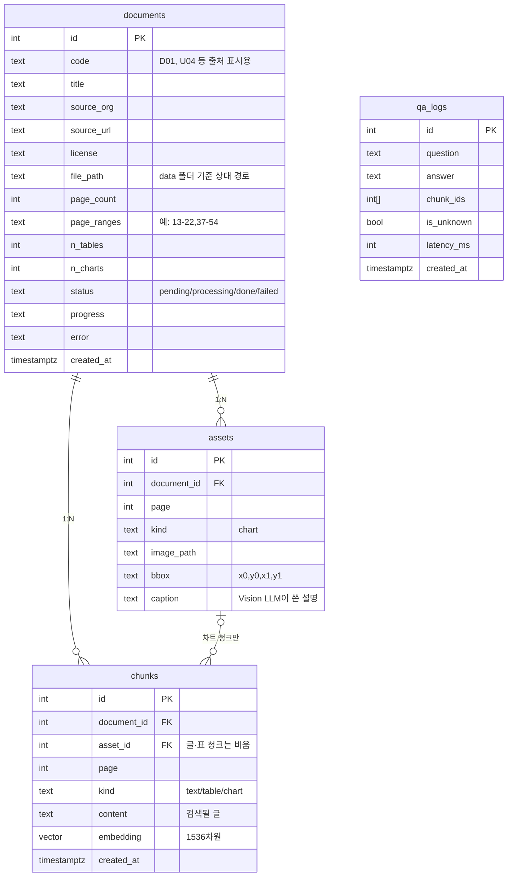

# 데이터베이스 구조

PostgreSQL + pgvector 하나에 **문서 정보, 검색용 글, 벡터**를 함께 저장합니다.
실제 SQL: [app/db/schema.sql](../app/db/schema.sql) · 읽기/쓰기 함수: [app/db/repo.py](../app/db/repo.py)

## 표별 설명

| 표 | 한 줄의 의미 | 언제 만들어지나 |
|---|---|---|
| `documents` | 문서 1개 | PDF 업로드(`POST /documents`) 또는 `python -m app.ingest.load_samples` |
| `assets` | 차트 이미지 1개 (페이지 폭 띠) | 문서 처리 중 차트를 찾았을 때 |
| `chunks` | 검색 단위 1개 (본문 800자 / 표 행 묶음 / 차트 캡션) | 문서 처리 마지막 단계 |
| `qa_logs` | 질문 1개 | `POST /ask` 마다 |

## 설계 메모
- **문서 코드(`code`):** 답변의 출처 표시 `[D01 p.8]`에 씁니다. 기본 문서는 D01~D03, 직접 올린 문서는 `U` + 번호입니다.
- **경로는 상대 경로로 저장:** 내 PC(`~/…/ReportQA/data`)와 Docker(`/app/data`)에서 data 폴더 위치가 달라도 같은 DB를 쓸 수 있게 합니다.
- **삭제:** 문서를 지우면 `ON DELETE CASCADE`로 청크·이미지 기록이 함께 지워집니다.
- **벡터 색인:** `chunks.embedding`에 HNSW 색인(코사인 거리)을 걸어 청크가 많아져도 빠르게 찾습니다.
- **BM25 키워드 색인은 DB에 두지 않습니다.** 서버가 처음 질문을 받을 때 `chunks` 내용을 읽어 메모리에 만들고, 문서가 추가·삭제되면 다시 만듭니다.
